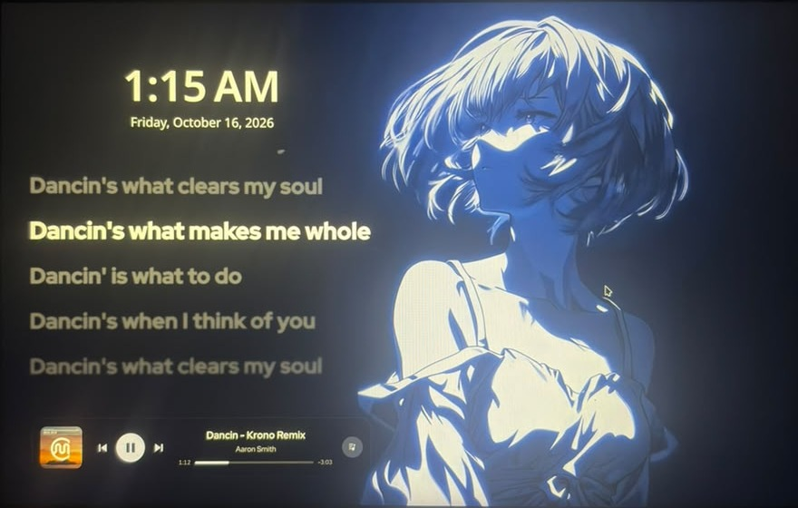

# kde-lockscreen-lyrics

Media controls and Apple Music-style synced lyrics on the KDE Plasma 6 lock screen, for Spotify, YouTube in any browser, and other players. Live/video wallpapers keep working.



▶ **[Watch the demo video](docs/lockscreen-demo.mp4)** (10 s, the lyrics moving with the song)

## What you get

- **Any player**: follows whatever is playing (Spotify, YouTube in Brave/Chrome/Edge/Firefox, VLC ...). Cover and lyrics always belong to the song shown, never a previous one
- **YouTube**: the video's thumbnail, its captions as lyrics when it has them, else LRCLIB lyrics for the song in the title. Ads don't scroll the lyrics
- **Media controller** on the idle lock screen (the one right after <kbd>Meta</kbd>+<kbd>L</kbd>): album cover, title, artist, progress bar, ⏮ ⏯ ⏭
- **Synced lyrics** on the left: current line bright, others dimmed and blurred, sliding as the song plays
- **Lyrics toggle** button, shown only when the song has synced lyrics
- **Mouse-friendly idle screen**: moving the mouse or clicking the controller doesn't open the password prompt; a key press does
- **Instant lyrics** for the 25 songs before and after the current one, downloaded ahead of time
- **Local cache** of up to 500 songs (least recently used deleted first), so repeat songs need no internet; YouTube thumbnails and captions are kept for 7 days

## How it works

```
Any player ──MPRIS/D-Bus──► lockscreen-media-helper ──► ~/.cache/kde-lockscreen-lyrics/cover.jpg
   │                           (current song)                                lyrics.lrc
   │                                                                         now.txt  (which song these are)
   └──Spotify Web API──► lockscreen-lyrics-prefetch ──► songs/<track-id>.jpg / .lrc  (cache)
                           (±25 Spotify songs)                       │
                                                                     ▼
                                                   Lock screen QML reads the files
```

- **The lock screen can't use the internet**, so two background services (systemd user units) download everything into `~/.cache` and the lock screen only reads files.
- **`helper/lockscreen-media-helper`** (Python): asks `playerctl` every second which players exist and picks the one to show (playing first, then Spotify). On every song change it clears the old files, writes `now.txt`, then fills `cover.jpg` and `lyrics.lrc` in the background:
  - **Spotify**: cover and [LRCLIB](https://lrclib.net) lyrics, saved in `songs/`.
  - **Browsers**: the browser's thumbnail right away; for YouTube the HD thumbnail and lyrics from, in order, the video's own captions, LRCLIB, auto-generated captions. Videos with an intro get LRCLIB lyrics shifted to match. During an ad (same title, different length) lyrics stay hidden.
  - **Other players**: their cover and LRCLIB lyrics.
- **`helper/lockscreen-lyrics-prefetch`** (Python): asks the Spotify Web API which playlist, album or Liked Songs list is playing and where, then fetches +1, −1, +2, −2 … up to ±25 into `songs/`. With shuffle, radio or mixes it uses Spotify's queue and recently played. Requests to LRCLIB are spaced out and back off on HTTP 429.
- **`lockscreen/MediaFiles.qml`**: every 0.5 s runs `stat` on the three files and re-reads them when they change (QML can't read local files directly on the lock screen, so it runs shell commands through Plasma's executable engine).
- **`lockscreen/NowPlaying.qml`**: the controller; talks to the player through KDE's MPRIS module, keeps the song position for the lyrics, and only uses the files when `now.txt` names the song it shows.
- **`lockscreen/LyricsView.qml`**: parses LRC (`[01:23.45] words`), picks the current line from the position, and animates the list.
- **`install.sh`**: copies `lockscreen/` into `/usr/share/plasma/shells/org.kde.plasma.desktop/contents/lockscreen/` (sudo) and installs/enables both services. `upstream/` holds KDE's untouched originals, for comparing after Plasma updates.

## Install

Requirements: KDE Plasma 6, `playerctl`, `python3`. For YouTube thumbnails and captions also `yt-dlp` and `nodejs22` (`sudo dnf install yt-dlp nodejs22`); without them YouTube still gets LRCLIB lyrics.

```bash
./install.sh
/usr/libexec/kscreenlocker_greet --testing     # try it without really locking
```

Optional, for the ±25-song prefetch: create an app at [developer.spotify.com](https://developer.spotify.com/dashboard) with redirect URI `http://127.0.0.1:8888/callback` (Web API), then:

```bash
mkdir -p ~/.config/kde-lockscreen-lyrics
echo YOUR_CLIENT_ID > ~/.config/kde-lockscreen-lyrics/spotify-client-id
lockscreen-lyrics-prefetch --login
systemctl --user restart lockscreen-lyrics-prefetch
```

### YouTube in Brave, Chrome or Edge

These browsers don't tell the system which video is playing, so the helper finds it by searching for the title and channel. For an exact match, install KDE's **Plasma Integration** extension ([Chrome Web Store](https://chromewebstore.google.com/detail/plasma-integration/cimiefiiaegbelhefglklhhakcgmhkai), works in Brave; Edge Add-ons for Edge). Fedora's `plasma-browser-integration` package already installed the system side. Firefox needs nothing.

Check what the helper sees:

```bash
lockscreen-media-helper --status
```

Re-run `./install.sh` after every `plasma-desktop` update, because updates overwrite the lock screen files.

## Undo

```bash
systemctl --user disable --now lockscreen-media-helper lockscreen-lyrics-prefetch
sudo dnf reinstall plasma-desktop      # restores KDE's original lock screen
```

## Credits

KDE Plasma (lock screen, GPL-2.0-or-later) · SilentSDDM (theme pieces, GPL-3.0) · [LRCLIB](https://lrclib.net) (lyrics) · [yt-dlp](https://github.com/yt-dlp/yt-dlp) (YouTube captions). This project is GPL-3.0.
